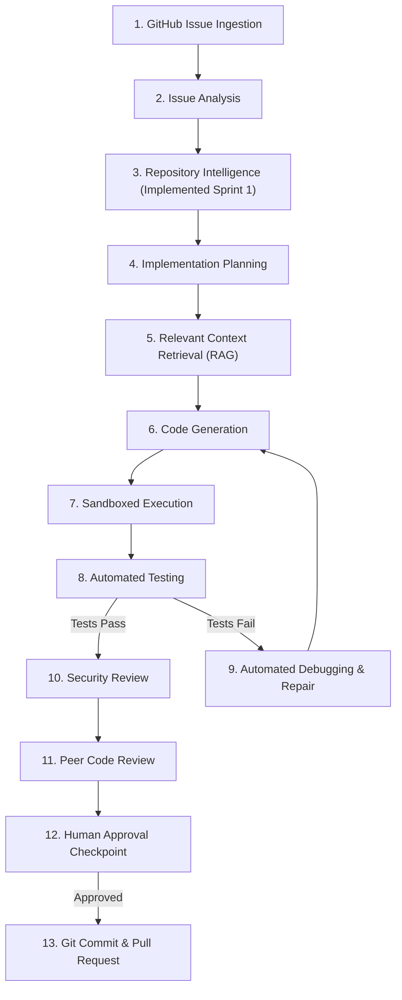

# AgentForge

> Autonomous AI Software Engineer — from GitHub Issue to Tested Pull Request.

[](https://github.com/swikarb69/AgentForge/actions/workflows/ci.yml)
[](LICENSE)
[](pyproject.toml)
[](https://github.com/astral-sh/ruff)
[](https://mypy-lang.org/)

AgentForge is an autonomous AI software-engineering agent designed to take a GitHub issue, analyze the target repository, formulate a minimal implementation plan, synthesize code and tests, execute tests inside an isolated sandbox, repair failures automatically, perform security and peer code reviews, and deliver an auditable Pull Request.

The core operational principle governing AgentForge is:

$$\text{Understand} \longrightarrow \text{Plan} \longrightarrow \text{Implement} \longrightarrow \text{Verify} \longrightarrow \text{Repair} \longrightarrow \text{Review} \longrightarrow \text{Ship}$$

---

## Current Project Status

> [!NOTE]
> **Sprint 8 — Human Approval & Controlled Release Engine (Current Release: v0.9.0)**
>
> AgentForge is being built incrementally using an **Agile + Scrum-inspired iterative methodology**.
>
> **Implemented in Sprints 0 through 8**:
> - Core FastAPI application foundation (`backend/app/main.py`) & Pydantic settings config (`backend/app/core/config.py`).
> - **Repository Intelligence Subsystem**: Scanner, AST Parser, Code Chunker, In-Memory Repository Index, and Deterministic Search (`backend/app/repository/`, `backend/app/parsing/`, `backend/app/indexing/`).
> - **Issue Intelligence Subsystem**: Issue Parser (`IssueParser`), Requirement Extractor (`RequirementExtractor`), Entity & Reference Extractor (`ReferenceExtractor`), and Repository-Aware Matcher (`IssueMatcher`) (`backend/app/issue/`).
> - **Issue Context Pipeline**: High-level service (`IssueContextBuilder`) mapping software issue requirements directly to codebase files, symbols, and code chunks with explainable scoring breakdowns and unresolved reference tracking.
> - **Planning Engine Subsystem**: Impact analysis, implementation task generation, requirement traceability, acceptance verification planning, dependency analysis & cycle detection, risk analysis, grounded assumption extraction, plan validation, and planning service (`backend/app/planning/`).
> - **Code Generation Engine Subsystem**: Bounded source context extraction, replaceable provider interface (Mock & Gemini), versioned injection-resistant prompt templates (`v1.0`), structured code generator, patch validator with AST syntax checking, unified diff patch builder, and artifact storage (`backend/app/generation/`).
> - **Execution & Verification Sandbox Subsystem**: Ephemeral isolated workspace manager with sensitive file filtering and quotas, secure patch application with path traversal / protected file defenses, locked-down Docker runner with unprivileged non-root user `10001:10001`, dropped capabilities `ALL`, read-only rootfs, tmpfs, network isolation `none`, and strict No-Host-Fallback, test execution parser, and verification engine (`backend/app/execution/`).
> - **Debugging & Automatic Repair Subsystem**: Failure classification, evidence collection & stack trace attribution, root cause analysis engine, bounded repair strategy engine, bounded repair proposal generation, isolated ephemeral sandbox verification, loop & duplicate patch detection via SHA-256 hashing, human review escalation for environment defects, and high-risk approval pauses (`backend/app/debugging/`).
> - **Code Review & Quality Assurance Subsystem**: 24 built-in deterministic rules across 7 categories, deterministic AST static analyzer, security vulnerability pattern detector (SQL injection, shell injection, code execution, secret leakage with redaction, path traversal, deserialization, tempfiles), architecture analyzer (circular import DFS cycle detection, unidirectional layer boundaries, unapproved dependencies, coupling), regression analyzer (plan scope compliance, acceptance criteria verification, sandbox verification defects, test assertion validation), evidence collector with SHA-256 hashing, explainable 0-100 quality scoring, gating state machine (`APPROVED`, `APPROVED_WITH_COMMENTS`, `REQUIRES_CHANGES`, `BLOCKED`), markdown report generation, and repository immutability (`backend/app/review/`).
> - **Human Approval & Controlled Release Subsystem**: Explicit human authorization boundary, separation of duties, role-based & risk-tiered approval policies (LOW, MEDIUM, HIGH, CRITICAL), deterministic state machine, on-read & sweep expiration management, SHA-256 hash-chained tamper-evident audit trail with secret sanitization, 13-point release readiness validation engine, controlled release providers (Mock & GitHub REST), zero-auto-merge enforcement (strictly creates release candidate branches and pull requests), and release tracking (`backend/app/approval/`).
> - **REST APIs**: Endpoints across Repositories, Issues, Planning, Generation, Execution, Debugging, Reviews, and Human Approval & Controlled Release (`/api/v1/approval/requests`, `/api/v1/approval/requests/{id}/decide`, `/api/v1/approval/requests/{id}/readiness`, `/api/v1/approval/requests/{id}/release`, `/api/v1/approval/requests/{id}/audit/verify`, `/api/v1/approval/releases`).
> - **Testing Architecture**: Pytest unit, integration, and security test suite (`tests/`) with 100+ passing approval tests and $\ge 90\%$ subsystem coverage.
> - **CI/CD & Security**: GitHub Actions pipeline (`.github/workflows/ci.yml`) enforcing Ruff, MyPy, Bandit, and Pytest.

---

## Why AgentForge?

Building reliable AI software engineering agents requires far more than wrapping an LLM in a loop. Monolithic code generation leads to regression bugs, bloated diffs, and security vulnerabilities.

AgentForge addresses these issues through:
1. **Repository Intelligence & RAG**: Context extraction via file tree analysis, AST parsing, and symbol indexing.
2. **Specialized Multi-Agent System**: 9 single-responsibility agents (Repo Analyst, Issue Analyst, Planner, Coder, Test Agent, Debugger, Security Agent, Code Reviewer, PR Agent).
3. **Sandboxed Code Execution**: Docker container isolation operating under strict CPU, memory, timeout, and network constraints.
4. **Automated Multi-Turn Repair Loop**: Test-driven failure analysis and patch refinement prior to human review.
5. **Deterministic Security Controls**: Hard limits against command injection, secret leakage, and path traversal.
6. **Human-in-the-Loop Control**: Configurable approval gates before committing or opening pull requests.

---

## End-to-End Operational Workflow



---

## Technology Stack

- **Language**: Python 3.13+
- **API Framework**: FastAPI & Uvicorn
- **Configuration & Validation**: Pydantic v2 & Pydantic Settings
- **Testing**: Pytest, Pytest-Cov, Pytest-Asyncio
- **Code Quality & Formatting**: Ruff, MyPy
- **Security Scanner**: Bandit
- **Containerization**: Docker & Docker Compose
- **CI/CD**: GitHub Actions

---

## Repository Structure

```text
AgentForge/
├── backend/
│   └── app/
│       ├── __init__.py
│       ├── main.py                    # FastAPI entrypoint
│       ├── api/
│       │   └── routes/
│       │       ├── debugging.py       # Debugging & Automatic Repair APIs
│       │       ├── execution.py       # Sandboxed Execution APIs
│       │       ├── generation.py      # Code Generation APIs
│       │       ├── issues.py          # Issue Intelligence APIs
│       │       ├── planning.py        # Planning Engine APIs
│       │       └── repositories.py    # Repository Analysis & Search APIs
│       ├── core/
│       │   └── config.py              # Pydantic Settings
│       ├── debugging/
│       │   ├── classifier.py          # Failure classification engine
│       │   ├── evidence_collector.py  # Failure evidence & stack trace attribution
│       │   ├── models.py              # Debugging & repair state schemas
│       │   ├── repair_controller.py   # State machine orchestration & loop detection
│       │   ├── repair_engine.py       # Bounded code repair generation
│       │   ├── repair_evaluator.py    # Sandbox evaluation & regression checker
│       │   ├── repair_strategy.py     # Strategy selection & risk assessment
│       │   ├── root_cause.py          # Diagnostic root cause analyzer
│       │   └── service.py             # Debugging session management service
│       ├── execution/
│       │   ├── applier.py             # Safe patch applier
│       │   ├── docker_runner.py       # Hardened Docker execution runner
│       │   ├── models.py              # Execution & verification schemas
│       │   ├── parser.py              # Test output parser
│       │   ├── service.py             # Verification engine service
│       │   └── workspace.py           # Ephemeral workspace manager
│       ├── generation/
│       │   ├── generator.py           # Structured code generator
│       │   ├── models.py              # Generation schemas
│       │   ├── patch_builder.py       # Unified diff builder
│       │   ├── prompts.py             # Prompt templates
│       │   ├── providers.py           # Mock & Gemini LLM providers
│       │   └── validator.py           # AST patch validator
│       ├── indexing/
│       │   ├── chunker.py             # Structural code chunker
│       │   └── index.py               # In-memory repository index & search
│       ├── issue/
│       │   ├── builder.py             # IssueContext builder
│       │   ├── matcher.py             # Repository-aware issue matcher
│       │   ├── models.py              # Issue intelligence schemas
│       │   ├── parser.py              # Issue & requirement parser
│       │   └── references.py          # Symbol & entity extractor
│       ├── parsing/
│       │   ├── python_parser.py       # Python AST parser
│       │   └── symbols.py             # AST node helpers
│       ├── planning/
│       │   ├── analyzer.py            # Impact analyzer
│       │   ├── generator.py           # Implementation task generator
│       │   ├── graph.py               # Dependency graph & cycle detector
│       │   ├── models.py              # Planning schemas
│       │   ├── risk.py                # Risk & assumption analyzer
│       │   ├── service.py             # Planning service
│       │   └── validator.py           # Plan validator
│       └── repository/
│           ├── analyzer.py            # High-level RepositoryAnalyzer pipeline
│           ├── filters.py             # Path validation & ignore rules
│           ├── metadata.py            # Language detection & test classifier
│           ├── models.py              # Pydantic data schemas
│           └── scanner.py             # Recursive filesystem scanner
│
├── agentforge-fixtures/
│   └── sample-project/                # Fixture repository for integration testing
│
├── sandbox/
│   ├── Dockerfile                    # Isolated sandbox container baseline
│   └── policies/
│       └── security_policy.json       # Baseline security limits & policy schema
│
├── tests/
│   ├── unit/                          # Unit test suite
│   └── integration/                   # Pipeline & API integration test suite
│
├── docs/                              # Architecture & specification docs
│   ├── architecture.md
│   ├── development-methodology.md
│   ├── repository-intelligence.md
│   ├── issue-intelligence.md
│   ├── planning-engine.md
│   ├── code-generation.md
│   ├── execution-sandbox.md
│   ├── security.md
│   ├── testing.md
│   ├── deployment.md
│   └── roadmap.md
│
├── .github/
│   └── workflows/
│       └── ci.yml                    # GitHub Actions CI pipeline
│
├── .env.example                      # Environment variables template
├── .gitignore                        # Git exclusion rules
├── CHANGELOG.md                      # Release notes
├── CONTRIBUTING.md                   # Contribution guidelines
├── LICENSE                           # MIT License
├── README.md                         # Documentation
├── docker-compose.yml                # Local container orchestration
└── pyproject.toml                    # Build & tool configuration
```

---

## Quick Start & Usage

### 1. Setup Local Environment
```bash
# Clone repository
git clone https://github.com/swikarb69/AgentForge.git
cd AgentForge

# Create and activate virtual environment
python -m venv .venv
# Windows:
.venv\Scripts\activate
# Linux/macOS:
source .venv/bin/activate

# Install dependencies
pip install -e ".[dev]"
```

### 2. Run FastAPI Application
```bash
uvicorn backend.app.main:app --reload --port 8000
```
Endpoints:
- Health Check: `http://localhost:8000/api/v1/health`
- Version Info: `http://localhost:8000/api/v1/version`
- Analyze Repository: `POST http://localhost:8000/api/v1/repositories/analyze`
- Search Repository: `POST http://localhost:8000/api/v1/repositories/search`
- Analyze Issue: `POST http://localhost:8000/api/v1/issues/analyze`
- Issue Context: `POST http://localhost:8000/api/v1/issues/context`
- Create Plan: `POST http://localhost:8000/api/v1/planning/create`
- Validate Plan: `POST http://localhost:8000/api/v1/planning/validate`
- Generate Code & Patch: `POST http://localhost:8000/api/v1/generation/create`
- Get Generation: `GET http://localhost:8000/api/v1/generation/{generation_id}`
- Get Unified Patch: `GET http://localhost:8000/api/v1/generation/{generation_id}/patch`
- Run Sandboxed Execution: `POST http://localhost:8000/api/v1/execution/create`
- List Verification Reports: `GET http://localhost:8000/api/v1/execution/reports`
- Get Verification Report: `GET http://localhost:8000/api/v1/execution/reports/{execution_id}`
- Trigger Automated Repair: `POST http://localhost:8000/api/v1/debugging/repair`
- List Repair Sessions: `GET http://localhost:8000/api/v1/debugging/repairs`
- Get Repair Status: `GET http://localhost:8000/api/v1/debugging/repair/{repair_id}`
- Get Repair Iteration History: `GET http://localhost:8000/api/v1/debugging/repair/{repair_id}/history`
- Create Approval Request: `POST http://localhost:8000/api/v1/approval/requests`
- List Approval Requests: `GET http://localhost:8000/api/v1/approval/requests`
- Get Approval Request: `GET http://localhost:8000/api/v1/approval/requests/{id}`
- Submit Human Decision: `POST http://localhost:8000/api/v1/approval/requests/{id}/decide`
- Revoke Approval: `POST http://localhost:8000/api/v1/approval/requests/{id}/revoke`
- Evaluate Release Readiness: `GET http://localhost:8000/api/v1/approval/requests/{id}/readiness`
- Execute Controlled Release: `POST http://localhost:8000/api/v1/approval/requests/{id}/release`
- Verify Audit Hash Chain: `GET http://localhost:8000/api/v1/approval/requests/{id}/audit/verify`
- List Releases: `GET http://localhost:8000/api/v1/approval/releases`
- OpenAPI Docs: `http://localhost:8000/docs`

---

## Testing & Quality Verification

Run the full local quality and verification suite:

```bash
# Run Ruff Linters & Formatters
ruff check .
ruff format --check .

# Run MyPy Static Type Check
mypy backend/app

# Run Bandit Security Scanner
bandit -r backend/app

# Run Unit & Integration Tests with Coverage
pytest --cov=backend/app --cov-report=term-missing
```

---

## Planned 11-Sprint Roadmap

- **Sprint 0 — Foundation** (COMPLETED): Base application structure, config, testing, CI, docs.
- **Sprint 1 — Repository Intelligence** (COMPLETED): Scanner, AST parser, chunker, in-memory index, search API.
- **Sprint 2 — Issue Intelligence** (COMPLETED): Issue parser, requirement extractor, reference extractor, issue matcher.
- **Sprint 3 — Planning Engine** (COMPLETED): Impact analyzer, task generator, dependency graph, risk analyzer, plan validator.
- **Sprint 4 — Code Generation Engine** (COMPLETED): Source context builder, mock & Gemini providers, AST syntax validator, unified patch builder.
- **Sprint 5 — Execution Sandbox Engine** (COMPLETED): Isolated workspace manager, secure patch applier, restricted Docker runner, test executor, verification engine.
- **Sprint 6 — Debugging & Automatic Repair Engine** (COMPLETED): Failure classification, root cause analysis, bounded repair loop, loop detection, sandbox verification.
- **Sprint 7 — Security & Code Review Engine** (COMPLETED): 24 static & security rules, AST analyzer, architecture cycles, regression analysis, report generator.
- **Sprint 8 — Human Approval & Controlled Release** (COMPLETED): Human authorization boundary, separation of duties, 13-point readiness validation, tamper-evident audit trail, release candidate branches & PRs.
- **Sprint 9 — Evaluation & Benchmarks** (NEXT): Benchmark evaluation suite and token/cost trackers.
- **Sprint 10 — Production Polish**: Developer UI dashboard and final audit.

For comprehensive sprint details, read [docs/roadmap.md](docs/roadmap.md).

---

## License

AgentForge is released under the **MIT License**. See [LICENSE](LICENSE) for details.

Copyright (c) 2026 **Swikar Bhattarai**

---

## Author

**Swikar Bhattarai**  
Repository: [https://github.com/swikarb69/AgentForge.git](https://github.com/swikarb69/AgentForge.git)
