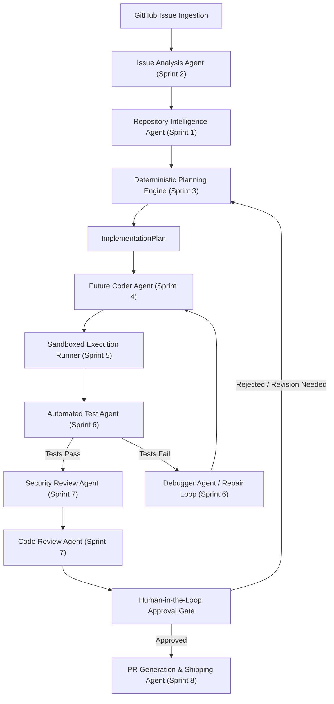

# AgentForge System Architecture

This document presents the technical architecture, core operational workflow, module boundaries, and system components of **AgentForge**.

---

## 1. System Implementation Status

> [!IMPORTANT]
> **Current Status**: **Sprint 3 — Planning Engine**
>
> - **IMPLEMENTED IN SPRINT 0, 1, 2 & 3**:
>   - FastAPI core application & Pydantic configuration (`backend/app/main.py`, `backend/app/core/config.py`).
>   - Repository Intelligence Subsystem (`backend/app/repository/`, `backend/app/parsing/`, `backend/app/indexing/`).
>   - Issue Intelligence Subsystem (`backend/app/issue/`): Parser, Requirement Extractor, Reference Extractor, Repository Matcher, Issue Context Pipeline.
>   - Planning Engine Subsystem (`backend/app/planning/`): Impact Analyzer, Task Generator & Traceability, Dependency Analyzer & Cycle Detection, Risk Analyzer, Plan Validator, and Planning Service.
>   - REST APIs: `/api/v1/health`, `/api/v1/version`, `/api/v1/repositories/analyze`, `/api/v1/repositories/search`, `/api/v1/issues/analyze`, `/api/v1/issues/context`, `/api/v1/planning/create`, `/api/v1/planning/validate`.
>   - Baseline Sandbox Dockerfile and Security Policy JSON (`sandbox/`).
>   - Unit, Integration, & Pipeline Test Suites with comprehensive code coverage (`tests/`).
>   - GitHub Actions CI Pipeline (`.github/workflows/ci.yml`).
>
> - **KEY ARCHITECTURAL PRINCIPLES**:
>   - Sprint 3 is completely deterministic.
>   - No LLM is currently involved.
>   - No target repository source code is modified.
>
> - **PLANNED FOR FUTURE SPRINTS**: AI Agent orchestration, LLM Planner, Coder Agent, RAG retrieval augmentation, GitHub API integration, Docker sandbox runtime isolation, automated repair loop, and developer UI dashboard.

---

## 2. End-to-End Operational Workflow



---

## 3. High-Level Architectural Components

```text
┌────────────────────────────────────────────────────────────────────────┐
│                        AgentForge Orchestrator                         │
└───────────────────┬────────────────────────────────────┬───────────────┘
                    │                                    │
    ┌───────────────┴───────────────┐                    │
    ▼                               ▼                    ▼
┌───────────────────────┐ ┌───────────────────┐ ┌───────────────────────┐
│ Repository            │ │ Issue Intelligence│ │ Planning Engine       │
│ Intelligence Subsystem│ │ Subsystem         │ │ Subsystem             │
│ (Implemented Sprint 1)│ │ (Implemented Sp 2)│ │ (Implemented Sprint 3)│
└───────────────────────┘ └───────────────────┘ └───────────┬───────────┘
                                                            │
                                                            ▼
┌───────────────────────┐ ┌───────────────────┐ ┌───────────────────────┐
│ Future Coder Agent    │ │ Isolated Sandbox  │ │ GitHub Integration &  │
│ (Sprint 4)            │ │ Execution Runner  │ │ PR Generation Engine  │
│                       │ │ (Sprint 5)        │ │ (Sprint 8)            │
└───────────────────────┘ └───────────────────┘ └───────────────────────┘
```
