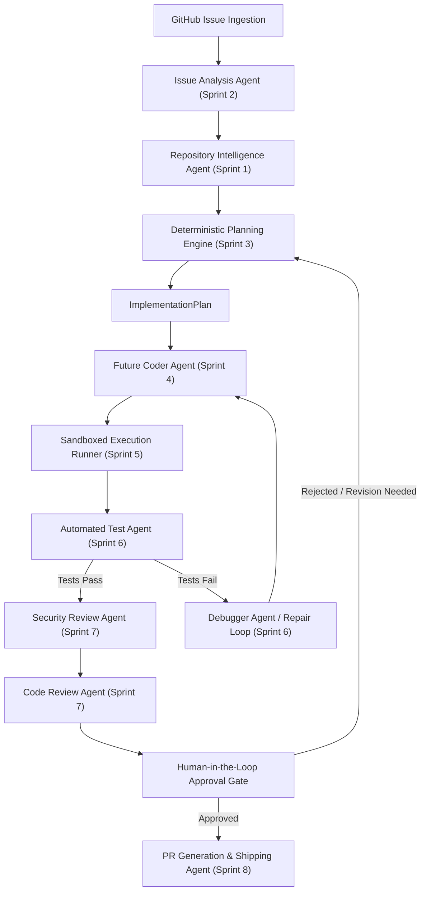

# AgentForge System Architecture

This document presents the technical architecture, core operational workflow, module boundaries, and system components of **AgentForge**.

---

## 1. System Implementation Status

> [!IMPORTANT]
> **Current Status**: **Sprint 7 — Code Review & Quality Assurance Engine**
>
> - **IMPLEMENTED IN SPRINTS 0 THROUGH 7**:
>   - FastAPI core application & Pydantic configuration (`backend/app/main.py`, `backend/app/core/config.py`).
>   - Repository Intelligence Subsystem (`backend/app/repository/`, `backend/app/parsing/`, `backend/app/indexing/`).
>   - Issue Intelligence Subsystem (`backend/app/issue/`): Parser, Requirement Extractor, Reference Extractor, Repository Matcher, Issue Context Pipeline.
>   - Planning Engine Subsystem (`backend/app/planning/`): Impact Analyzer, Task Generator & Traceability, Dependency Analyzer & Cycle Detection, Risk Analyzer, Plan Validator, and Planning Service.
>   - Code Generation Engine Subsystem (`backend/app/generation/`): Source Context Builder, Code Generator, Pluggable Providers (Mock & Gemini), Patch Validator, Patch Builder, and Generation Service.
>   - Execution & Verification Sandbox Subsystem (`backend/app/execution/`): Execution Policy, Ephemeral Workspace Manager, Secure Patch Applier, Restricted Docker Runner, Test Executor, Verification Engine, and Execution Service.
>   - Debugging and Automatic Repair Engine (`backend/app/debugging/`): Failure Classifier, Diagnostic Evidence Collector, Root Cause Analyzer, Repair Strategy Engine, Repair Proposal Engine, Repair Evaluator, Bounded Repair Controller, State Machine, and Debugging Service.
>   - Code Review & Quality Assurance Engine (`backend/app/review/`): Deterministic Static Analyzer, Security Analyzer, Architecture Analyzer, Regression Analyzer, Evidence Collector, Review Aggregator & Scoring Engine, and Review Service.
>   - REST APIs: `/api/v1/health`, `/api/v1/version`, `/api/v1/repositories/*`, `/api/v1/issues/*`, `/api/v1/planning/*`, `/api/v1/generation/*`, `/api/v1/execution/*`, `/api/v1/debugging/*`, and `/api/v1/reviews/*`.
>   - Baseline Sandbox Dockerfile and Security Policy JSON (`sandbox/`).
>   - Unit, Integration, & Security Test Suites with comprehensive code coverage (440 tests passing, $\ge 86\%$ coverage).
>   - GitHub Actions CI Pipeline (`.github/workflows/ci.yml`).
>
> - **KEY ARCHITECTURAL PRINCIPLES**:
>   - Read-only target repository: Target repository is never modified; reviews and patches operate in-memory or on ephemeral workspaces.
>   - Deterministic-first review: Review rules execute deterministic AST and pattern evaluations without external API dependencies.
>   - Evidence-grounded findings: Every finding links to bounded code excerpts with active secret redaction and SHA-256 fingerprints.
>   - Strict No-Host-Fallback: Sandboxed execution runs strictly inside Docker containers; failure to run in Docker fails deterministically without running on host.
>   - Non-root & dropped capabilities: Container runs as unprivileged UID/GID `10001:10001` with `cap_drop=["ALL"]`, read-only rootfs, and disabled network (`none`).
>   - Plan-authorized scope: Only files and operations explicitly authorized by the `ImplementationPlan` are permitted.
>   - Bounded Repair & Loop Detection: Repair attempts are strictly capped (default 3, hard limit 5) with SHA-256 patch hashing to eliminate infinite repair oscillations.
>   - Human Approval Pause: High-risk strategies and critical review findings pause for human review rather than executing/approving automatically.
>
> - **PLANNED FOR FUTURE SPRINTS**: GitHub Integration & PR Shipping (Sprint 8), Evaluation Suite & Cost Analytics (Sprint 9).

---

## 2. End-to-End Operational Workflow



---

## 3. High-Level Architectural Components

```text
┌────────────────────────────────────────────────────────────────────────┐
│                        AgentForge Orchestrator                         │
└───────────────────┬────────────────────────────────────┬───────────────┘
                    │                                    │
    ┌───────────────┴───────────────┐                    │
    ▼                               ▼                    ▼
┌───────────────────────┐ ┌───────────────────┐ ┌───────────────────────┐
│ Repository            │ │ Issue Intelligence│ │ Planning Engine       │
│ Intelligence Subsystem│ │ Subsystem         │ │ Subsystem             │
│ (Implemented Sprint 1)│ │ (Implemented Sp 2)│ │ (Implemented Sprint 3)│
└───────────────────────┘ └───────────────────┘ └───────────┬───────────┘
                                                            │
                                                            ▼
┌───────────────────────┐ ┌───────────────────┐ ┌───────────────────────┐
│ Future Coder Agent    │ │ Isolated Sandbox  │ │ GitHub Integration &  │
│ (Sprint 4)            │ │ Execution Runner  │ │ PR Generation Engine  │
│                       │ │ (Sprint 5)        │ │ (Sprint 8)            │
└───────────────────────┘ └───────────────────┘ └───────────────────────┘
```
