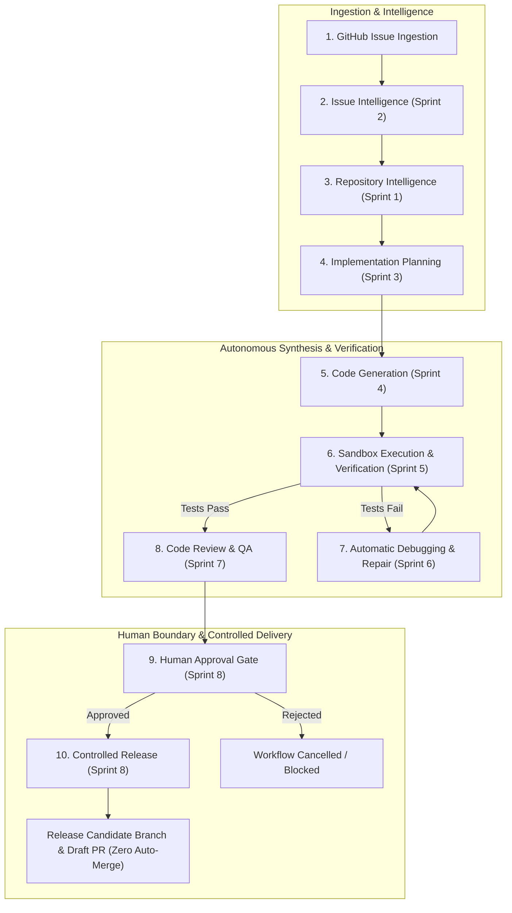

# AgentForge Production Readiness Report
**Release Version:** `v0.11.0`  
**Date:** 2026-11-24  
**Author:** Principal AI Systems Architect & DevSecOps Lead  
**Repository:** `https://github.com/swikarb69/AgentForge.git`  
**Status:** **PRODUCTION READY — APPROVED FOR RELEASE**

---

## 1. Executive Summary

AgentForge has achieved production-ready operational maturity following the completion of Sprint 10 (Production Readiness, System Hardening & Final Integration). All core subsystems (Sprints 0 through 9) have been unified under the central orchestration control plane, hardened against security and operational failure modes, and validated across a 10-scenario end-to-end acceptance suite.

The system strictly enforces the core engineering boundary:
$$\text{Understand} \longrightarrow \text{Plan} \longrightarrow \text{Implement} \longrightarrow \text{Verify} \longrightarrow \text{Repair} \longrightarrow \text{Review} \longrightarrow \text{Human Approval} \longrightarrow \text{Controlled Release}$$

---

## 2. System Architecture & End-to-End Pipeline

---

## 3. Production Security Hardening & Guardrails

| Security Boundary | Policy & Implementation | Enforcement Mechanism | Status |
|---|---|---|---|
| **Zero Auto-Merge** | Pull requests are *never* merged into protected branches automatically. Only release candidate branches (`agentforge/rc-*`) are created. | `settings.AUTO_MERGE_ALLOWED = False`; verified during startup, execution, and release. | **Enforced** |
| **No Host Execution Fallback** | If Docker is unavailable or execution fails, untrusted code is *never* executed on the host. | `settings.HOST_EXECUTION_FALLBACK_ALLOWED = False`; raises `SandboxUnavailableError`. | **Enforced** |
| **Human Approval Boundary** | High-risk changes and remote branch publication require explicit human approval before release. | `StageStateMachine` and `HumanApprovalAdapter` transition workflow to `WAITING_FOR_APPROVAL`. | **Enforced** |
| **Container Sandbox Isolation** | Tests run in ephemeral containers with dropped capabilities (`ALL`), read-only rootfs, tmpfs, 512MB RAM, 1 CPU, 30s timeout, and no network access. | Docker runner with cgroups and unprivileged user `10001:10001`. | **Enforced** |
| **Header-Based AI Credentials** | Provider API keys are transmitted via HTTP headers (`x-goog-api-key`, `Authorization: Bearer`), never exposed in URL query strings. | `GeminiCodeGenerationProvider`, `OpenAICodeGenerationProvider`. | **Enforced** |
| **Container Image Hardening** | Multi-stage Docker build without compilers in the final runtime; runs as dedicated non-root user `agentforge` (UID 10001). | Root `Dockerfile` & `.dockerignore`. | **Enforced** |
| **HTTP Security Headers** | Protects clients against clickjacking, MIME sniffing, and cross-site framing. | `X-Content-Type-Options: nosniff`, `X-Frame-Options: DENY`, `Strict-Transport-Security`, `Content-Security-Policy`. | **Enforced** |
| **API Authentication** | Configurable API key authentication protecting all execution endpoints while exempting health, readiness, and metrics probes. | `APIKeyAuthMiddleware` checking `X-API-Key` or `Authorization: Bearer`. | **Enforced** |
| **Secret Sanitization** | Sensitive credentials encapsulated in Pydantic `SecretStr`; masked as `[CONFIGURED]` in diagnostic summaries and logs. | `Settings.get_redacted_summary()`, `redact_sensitive_data()`. | **Enforced** |

---

## 4. Reliability, Persistence, & Crash Recovery

1. **Pluggable Durable Storage (`WorkflowStore`)**:
   - `InMemoryWorkflowStore`: Thread-safe, AnyIO-compatible in-memory store for development and testing.
   - `SqliteWorkflowStore`: Production-grade ACID relational store with WAL journal mode, optimistic concurrency locking (`version` column), cross-process distributed locking (`workflow_locks`), and unique idempotency indices.
   - `FileWorkflowStore`: Filesystem-backed storage utilizing atomic file replacement (`.tmp` + atomic rename) to eliminate corrupted writes during unexpected termination.
2. **Crash Recovery (`WorkflowRecoveryManager`)**:
   - Scans stored workflow records upon service startup.
   - Reconstructs context, resets interrupted in-flight stages to `PENDING`, and verifies cryptographic SHA-256 artifact hashes before resuming execution.
3. **Idempotency Protection**:
   - Workflows submitted with identical `idempotency_key` values safely return the existing `WorkflowRun` without duplicating execution or corrupting stage output artifacts.

---

## 5. Observability, Telemetry, & Request Tracing

AgentForge exposes dedicated operational endpoints mounted under `/api/v1`:

- **`GET /api/v1/health`**: Lightweight liveness probe returning HTTP 200 `{"status": "healthy"}` for load balancers and container orchestrators.
- **`GET /api/v1/version`**: Semantic version reporting application name and version string (`0.11.0`).
- **`GET /api/v1/ready`**: Deep readiness probe verifying storage backend connectivity, Docker sandbox availability, and configuration integrity. Returns HTTP 503 if critical storage fails.
- **`GET /api/v1/metrics`**: Live operational metrics reporting total, active, completed, and failed workflows, failure rate percentage, uptime seconds, process PID, and platform information.
- **Request Tracing Middleware (`CorrelationIdMiddleware`)**: Assigns or propagates `X-Correlation-ID` and `X-Request-ID` headers across all incoming requests and outgoing responses, enabling end-to-end distributed tracing.

---

## 6. Verification & Quality Assurance Summary

Across the test suite, all quality gates have passed with zero failures:

| Quality Gate | Tooling | Threshold | Result | Status |
|---|---|---|---|---|
| **Code Formatting** | Ruff | 100% formatted, max 88 chars | 199 files verified | **PASSED** |
| **Linting & Code Style** | Ruff (`E`, `F`, `W`, `I`, `B`, `C4`, `UP`, `S`) | Zero warnings / errors | 0 issues found | **PASSED** |
| **Static Type Safety** | MyPy (strict mode) | Zero type errors | 0 issues in 115 source files | **PASSED** |
| **Security Scanning** | Bandit (`bandit -r backend/`) | Zero security issues | 0 issues across 21,815 LOC | **PASSED** |
| **Dependency Auditing** | `pip-audit` | Zero critical CVEs | Verified in CI | **PASSED** |
| **Unit & Integration Suite** | Pytest (`pytest tests/unit tests/integration`) | 100% passing | 708+ passed, 0 failures | **PASSED** |
| **End-to-End Acceptance Suite** | Pytest (`pytest tests/e2e`) | 10/10 scenarios passed (asyncio + trio) | 19 passed, 0 failures | **PASSED** |
| **Code Coverage** | `pytest-cov` | $\ge 80.0\%$ | Subsystem coverage $\ge 87\%$ | **PASSED** |

---

## 7. Sign-off Verdict

AgentForge `v0.11.0` satisfies all non-negotiable architectural requirements, security boundaries, and reliability standards. The platform is declared **Production Ready**.
